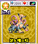

# 001 삼노메스타

## 기본 정보

| 항목 | 내용 |
| --- | --- |
| 도감 ID | 001 |
| 이름 | 삼노메스타 |
| 일본어 이름 | サムノメスタ |
| 속성 | 광(빛) |
| 종별 레벨 | Lv.1 |

종별 레벨은 종류별로 정해진 값이며, 아래의 랭크와 구분합니다.

## 드래건 설명

깜빡이는 빛으로 현혹해 최면을 건다. 안개 낀 골짜기에 산다.

카드 설명을 정리한 문장입니다. 실제 전투 효과와는 구분합니다.

## 랭크별 기본 능력치

| 랭크 | HP | STR | VIT | INT | MNT | AGI | DEX | LUK |
| ---: | ---: | ---: | ---: | ---: | ---: | ---: | ---: | ---: |
| 1 | 2,100 | 27 | 30 | 33 | 32 | 30 | 39 | 36 |
| 2 | 2,600 | 45 | 50 | 55 | 52 | 45 | 59 | 54 |
| 3 | 3,200 | 56 | 63 | 77 | 72 | 60 | 78 | 72 |
| 4 | 3,700 | 72 | 81 | 99 | 92 | 75 | 90 | 90 |
| 5 | 4,300 | 88 | 99 | 121 | 112 | 90 | 108 | 108 |

ROM에 저장된 기본값이며, 저장 데이터의 성장·개별 보정값은 포함하지 않습니다. 실제 획득 가능 랭크를 확정하는 표는 아닙니다.

`—`는 해당 랭크의 HP와 능력치가 모두 0인 슬롯입니다. 다른 수치와 함께 기록된 0은 그대로 표시했습니다.

[능력치와 대미지](../전투시스템/능력치와대미지.md) · [레벨과 랭크](../육성시스템/레벨과랭크.md)

## 사용 기술

랭크별로 기록된 전체 보유 목록입니다. 기술명을 누르면 AP, 효과와 사용 조건을 확인할 수 있습니다. 같은 이름도 기술 ID가 다르면 별도로 구분합니다.

| 랭크 | 기술 | 충전 | 방어 | 반격 |
| ---: | --- | --- | --- | --- |
| 1 | [클로](../기술목록/타격.md#slot-2100) (2100) [빔](../기술목록/브레스.md#slot-10) (10) | [HP 회복α](../기술목록/충전보조.md#slot-2150) (2150) [싱크로 회복α](../기술목록/충전보조.md#slot-2151) (2151) | [블록](../기술목록/방어.md#slot-2141) (2141) [스웨이](../기술목록/방어.md#slot-2142) (2142) | [반격 클로](../기술목록/반격반사.md#slot-2090) (2090) |
| 2 | [클로](../기술목록/타격.md#slot-2100) (2100) [하이 클로](../기술목록/타격.md#slot-2101) (2101) [빔](../기술목록/브레스.md#slot-10) (10) | [HP 회복α](../기술목록/충전보조.md#slot-2150) (2150) [싱크로 회복α](../기술목록/충전보조.md#slot-2151) (2151) [LUK 상승α](../기술목록/충전보조.md#slot-2158) (2158) | [블록](../기술목록/방어.md#slot-2141) (2141) [스웨이](../기술목록/방어.md#slot-2142) (2142) | [반격 클로](../기술목록/반격반사.md#slot-2090) (2090) |
| 3 | [클로](../기술목록/타격.md#slot-2100) (2100) [하이 클로](../기술목록/타격.md#slot-2101) (2101) [그레이트 클로](../기술목록/타격.md#slot-2102) (2102) [빔](../기술목록/브레스.md#slot-10) (10) | [HP 회복β](../기술목록/충전보조.md#slot-2160) (2160) [싱크로 회복α](../기술목록/충전보조.md#slot-2151) (2151) [LUK 상승α](../기술목록/충전보조.md#slot-2158) (2158) | [블록](../기술목록/방어.md#slot-2141) (2141) [스웨이](../기술목록/방어.md#slot-2142) (2142) | [반격 클로](../기술목록/반격반사.md#slot-2090) (2090) [리플렉트](../기술목록/반격반사.md#slot-2082) (2082) |
| 4 | [클로](../기술목록/타격.md#slot-2100) (2100) [하이 클로](../기술목록/타격.md#slot-2101) (2101) [그레이트 클로](../기술목록/타격.md#slot-2102) (2102) [빔](../기술목록/브레스.md#slot-10) (10) [난라람](../기술목록/탄.md#slot-11) (11) | [HP 회복β](../기술목록/충전보조.md#slot-2160) (2160) [싱크로 회복α](../기술목록/충전보조.md#slot-2151) (2151) [LUK 상승β](../기술목록/충전보조.md#slot-2168) (2168) [혼란 해제α](../기술목록/충전보조.md#slot-2194) (2194) | [블록](../기술목록/방어.md#slot-2141) (2141) [스웨이](../기술목록/방어.md#slot-2142) (2142) | [반격 클로](../기술목록/반격반사.md#slot-2090) (2090) [리플렉트](../기술목록/반격반사.md#slot-2082) (2082) |
| 5 | [클로](../기술목록/타격.md#slot-2100) (2100) [하이 클로](../기술목록/타격.md#slot-2101) (2101) [그레이트 클로](../기술목록/타격.md#slot-2102) (2102) [빔](../기술목록/브레스.md#slot-10) (10) [난라람](../기술목록/탄.md#slot-11) (11) [현혹 플래시](../기술목록/상태이상.md#slot-12) (12) | [HP 회복β](../기술목록/충전보조.md#slot-2160) (2160) [싱크로 회복β](../기술목록/충전보조.md#slot-2161) (2161) [LUK 상승β](../기술목록/충전보조.md#slot-2168) (2168) [혼란 해제α](../기술목록/충전보조.md#slot-2194) (2194) | [블록](../기술목록/방어.md#slot-2141) (2141) [스웨이](../기술목록/방어.md#slot-2142) (2142) | [반격 클로](../기술목록/반격반사.md#slot-2090) (2090) [리플렉트](../기술목록/반격반사.md#slot-2082) (2082) |

`—`는 해당 칸에 유효 기술 ID가 기록되지 않았다는 뜻입니다. 실제 획득 가능 랭크나 특수 성장·변신으로 열리는 기술을 확정하는 표는 아닙니다.

[기술 목록](../기술목록/index.md) · [랭크업](../육성시스템/랭크업.md)

## 변신

이 드래건의 변신 여부와 조건은 확인되지 않았습니다.

[변신 목록](../변신목록/index.md)

## 자료와 확인 범위

V29 ROM 기반 추출 자료를 도감 ID 1로 대조하여 구성했습니다.

| 반영 항목 | 원본 자료와 식별 기준 |
| --- | --- |
| 이름·종별 레벨·속성 | 드래곤목록.md, ID 1 |
| 카드 설명 | 드래건카드목록.md, ID 1의 한글 설명 |
| 랭크별 기본 능력치 | 드래건랭크별능력치.md, 랭크 1~5 각각의 ID 1 |
| 랭크별 보유 기술 | 드래건랭크별보유기술.md, ID 1의 랭크 1~5 |
| 카드 이미지 | image/드래건이미지갤러리.md, image/cards/001.png |

획득 방법과 실제 획득 가능 랭크는 추가 확인이 필요합니다. 보유 기술은 랭크 테이블 기준이며 전투 중 사용 조건은 개별 기술 설명을 참고하세요.

[드래건 도감](index.md) · [아카츠키 보마](002.md) →
