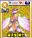

# 012 플로럴 페인

## 기본 정보

| 항목 | 내용 |
| --- | --- |
| 도감 ID | 012 |
| 이름 | 플로럴 페인 |
| 일본어 이름 | フローラルフェーン |
| 속성 | 광(빛) |
| 종별 레벨 | Lv.4 |

종별 레벨은 종류별로 정해진 값이며, 아래의 랭크와 구분합니다.

## 드래건 설명

공격력은 낮지만 능력은 뛰어나다. 현혹과 온 힘을 담은 일격을 피하기 어렵다.

카드 설명을 정리한 문장입니다. 실제 전투 효과와는 구분합니다.

## 랭크별 기본 능력치

| 랭크 | HP | STR | VIT | INT | MNT | AGI | DEX | LUK |
| ---: | ---: | ---: | ---: | ---: | ---: | ---: | ---: | ---: |
| 1 | 6,300 | 60 | 53 | 105 | 90 | 55 | 54 | 36 |
| 2 | 6,800 | 76 | 67 | 133 | 114 | 72 | 68 | 45 |
| 3 | 7,300 | 92 | 81 | 161 | 138 | 88 | 81 | 54 |
| 4 | 7,800 | 108 | 95 | 189 | 162 | 105 | 95 | 63 |
| 5 | 8,300 | 124 | 109 | 217 | 186 | 121 | 108 | 72 |

ROM에 저장된 기본값이며, 저장 데이터의 성장·개별 보정값은 포함하지 않습니다. 실제 획득 가능 랭크를 확정하는 표는 아닙니다.

`—`는 해당 랭크의 HP와 능력치가 모두 0인 슬롯입니다. 다른 수치와 함께 기록된 0은 그대로 표시했습니다.

[능력치와 대미지](../전투시스템/능력치와대미지.md) · [레벨과 랭크](../육성시스템/레벨과랭크.md)

## 사용 기술

랭크별로 기록된 전체 보유 목록입니다. 기술명을 누르면 AP, 효과와 사용 조건을 확인할 수 있습니다. 같은 이름도 기술 ID가 다르면 별도로 구분합니다.

| 랭크 | 기술 | 충전 | 방어 | 반격 |
| ---: | --- | --- | --- | --- |
| 1 | [혼](../기술목록/타격.md#slot-2118) (2118) [유리광진](../기술목록/충전보조.md#slot-121) (121) | [HP 회복α](../기술목록/충전보조.md#slot-2150) (2150) [싱크로 회복β](../기술목록/충전보조.md#slot-2161) (2161) | [블록](../기술목록/방어.md#slot-2141) (2141) [스웨이](../기술목록/방어.md#slot-2142) (2142) | [AGI 상승γ](../기술목록/충전보조.md#slot-2176) (2176) [리플렉트](../기술목록/반격반사.md#slot-2082) (2082) [투기 베기](../기술목록/반격반사.md#slot-122) (122) |
| 2 | [혼](../기술목록/타격.md#slot-2118) (2118) [빅 혼](../기술목록/타격.md#slot-2119) (2119) [유리광진](../기술목록/충전보조.md#slot-121) (121) | [HP 회복α](../기술목록/충전보조.md#slot-2150) (2150) [싱크로 회복β](../기술목록/충전보조.md#slot-2161) (2161) [VIT 상승β](../기술목록/충전보조.md#slot-2163) (2163) | [블록](../기술목록/방어.md#slot-2141) (2141) [스웨이](../기술목록/방어.md#slot-2142) (2142) | [AGI 상승γ](../기술목록/충전보조.md#slot-2176) (2176) [리플렉트](../기술목록/반격반사.md#slot-2082) (2082) [투기 베기](../기술목록/반격반사.md#slot-122) (122) |
| 3 | [혼](../기술목록/타격.md#slot-2118) (2118) [빅 혼](../기술목록/타격.md#slot-2119) (2119) [킹 혼](../기술목록/타격.md#slot-2120) (2120) [유리광진](../기술목록/충전보조.md#slot-121) (121) | [HP 회복α](../기술목록/충전보조.md#slot-2150) (2150) [싱크로 회복β](../기술목록/충전보조.md#slot-2161) (2161) [VIT 상승β](../기술목록/충전보조.md#slot-2163) (2163) [MNT 상승β](../기술목록/충전보조.md#slot-2165) (2165) | [블록](../기술목록/방어.md#slot-2141) (2141) [스웨이](../기술목록/방어.md#slot-2142) (2142) | [AGI 상승γ](../기술목록/충전보조.md#slot-2176) (2176) [리플렉트](../기술목록/반격반사.md#slot-2082) (2082) [투기 베기](../기술목록/반격반사.md#slot-122) (122) |
| 4 | [혼](../기술목록/타격.md#slot-2118) (2118) [빅 혼](../기술목록/타격.md#slot-2119) (2119) [킹 혼](../기술목록/타격.md#slot-2120) (2120) [현혹향](../기술목록/상태이상.md#slot-120) (120) [유리광진](../기술목록/충전보조.md#slot-121) (121) | [HP 회복α](../기술목록/충전보조.md#slot-2150) (2150) [싱크로 회복β](../기술목록/충전보조.md#slot-2161) (2161) [VIT 상승β](../기술목록/충전보조.md#slot-2163) (2163) [MNT 상승β](../기술목록/충전보조.md#slot-2165) (2165) [LUK 상승β](../기술목록/충전보조.md#slot-2168) (2168) [혼란 해제β](../기술목록/충전보조.md#slot-2204) (2204) | [블록](../기술목록/방어.md#slot-2141) (2141) [스웨이](../기술목록/방어.md#slot-2142) (2142) | [AGI 상승γ](../기술목록/충전보조.md#slot-2176) (2176) [리플렉트](../기술목록/반격반사.md#slot-2082) (2082) [투기 베기](../기술목록/반격반사.md#slot-122) (122) |
| 5 | [혼](../기술목록/타격.md#slot-2118) (2118) [빅 혼](../기술목록/타격.md#slot-2119) (2119) [킹 혼](../기술목록/타격.md#slot-2120) (2120) [현혹향](../기술목록/상태이상.md#slot-120) (120) [유리광진](../기술목록/충전보조.md#slot-121) (121) | [HP 회복α](../기술목록/충전보조.md#slot-2150) (2150) [싱크로 회복β](../기술목록/충전보조.md#slot-2161) (2161) [VIT 상승β](../기술목록/충전보조.md#slot-2163) (2163) [MNT 상승β](../기술목록/충전보조.md#slot-2165) (2165) [LUK 상승γ](../기술목록/충전보조.md#slot-2178) (2178) [혼란 해제β](../기술목록/충전보조.md#slot-2204) (2204) | [블록](../기술목록/방어.md#slot-2141) (2141) [스웨이](../기술목록/방어.md#slot-2142) (2142) | [AGI 상승γ](../기술목록/충전보조.md#slot-2176) (2176) [리플렉트](../기술목록/반격반사.md#slot-2082) (2082) [투기 베기](../기술목록/반격반사.md#slot-122) (122) [광아](../기술목록/반격반사.md#slot-123) (123) |

`—`는 해당 칸에 유효 기술 ID가 기록되지 않았다는 뜻입니다. 실제 획득 가능 랭크나 특수 성장·변신으로 열리는 기술을 확정하는 표는 아닙니다.

원본의 랭크 1~5 방어 네 번째 칸에 기술 ID 범위 밖의 값이 있어, 유효 기술 목록에서 제외되어 있습니다.

[기술 목록](../기술목록/index.md) · [랭크업](../육성시스템/랭크업.md)

## 변신

이 드래건의 변신 여부와 조건은 확인되지 않았습니다.

[변신 목록](../변신목록/index.md)

## 자료와 확인 범위

V29 ROM 기반 추출 자료를 도감 ID 12로 대조하여 구성했습니다.

| 반영 항목 | 원본 자료와 식별 기준 |
| --- | --- |
| 이름·종별 레벨·속성 | 드래곤목록.md, ID 12 |
| 카드 설명 | 드래건카드목록.md, ID 12의 한글 설명 |
| 랭크별 기본 능력치 | 드래건랭크별능력치.md, 랭크 1~5 각각의 ID 12 |
| 랭크별 보유 기술 | 드래건랭크별보유기술.md, ID 12의 랭크 1~5 |
| 카드 이미지 | image/드래건이미지갤러리.md, image/cards/012.png |

획득 방법과 실제 획득 가능 랭크는 추가 확인이 필요합니다. 보유 기술은 랭크 테이블 기준이며 전투 중 사용 조건은 개별 기술 설명을 참고하세요.

← [브라이트 폰](011.md) · [드래건 도감](index.md) · [샤이닝 애로](013.md) →
