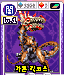

# 081 가콘 각코츠

## 기본 정보

| 항목 | 내용 |
| --- | --- |
| 도감 ID | 081 |
| 이름 | 가콘 각코츠 |
| 일본어 이름 | ガコンガッコツ |
| 속성 | 암(어둠) |
| 종별 레벨 | Lv.1 |

종별 레벨은 종류별로 정해진 값이며, 아래의 랭크와 구분합니다.

## 드래건 설명

튼튼한 턱으로 한 번 물면 적의 숨이 끊어질 때까지 놓지 않는다. 그 끈기가 최대 무기다.

카드 설명을 정리한 문장입니다. 실제 전투 효과와는 구분합니다.

## 랭크별 기본 능력치

| 랭크 | HP | STR | VIT | INT | MNT | AGI | DEX | LUK |
| ---: | ---: | ---: | ---: | ---: | ---: | ---: | ---: | ---: |
| 1 | 4,000 | 18 | 12 | 21 | 9 | 3 | 18 | 12 |
| 2 | 5,250 | 35 | 25 | 40 | 20 | 9 | 32 | 23 |
| 3 | 6,600 | 56 | 42 | 63 | 35 | 18 | 48 | 36 |
| 4 | 8,050 | 90 | 72 | 99 | 63 | 38 | 75 | 60 |
| 5 | 9,600 | 132 | 110 | 143 | 99 | 63 | 108 | 90 |

ROM에 저장된 기본값이며, 저장 데이터의 성장·개별 보정값은 포함하지 않습니다. 실제 획득 가능 랭크를 확정하는 표는 아닙니다.

`—`는 해당 랭크의 HP와 능력치가 모두 0인 슬롯입니다. 다른 수치와 함께 기록된 0은 그대로 표시했습니다.

[능력치와 대미지](../전투시스템/능력치와대미지.md) · [레벨과 랭크](../육성시스템/레벨과랭크.md)

## 사용 기술

랭크별로 기록된 전체 보유 목록입니다. 기술명을 누르면 AP, 효과와 사용 조건을 확인할 수 있습니다. 같은 이름도 기술 ID가 다르면 별도로 구분합니다.

| 랭크 | 기술 | 충전 | 방어 | 반격 |
| ---: | --- | --- | --- | --- |
| 1 | [펀치](../기술목록/타격.md#slot-2131) (2131) [투박란](../기술목록/탄.md#slot-810) (810) | [HP 회복α](../기술목록/충전보조.md#slot-2150) (2150) [싱크로 회복α](../기술목록/충전보조.md#slot-2151) (2151) [VIT 상승α](../기술목록/충전보조.md#slot-2153) (2153) | [블록](../기술목록/방어.md#slot-2141) (2141) [스웨이](../기술목록/방어.md#slot-2142) (2142) | [반격 펀치](../기술목록/반격반사.md#slot-2095) (2095) [리플렉트](../기술목록/반격반사.md#slot-2082) (2082) [대칭혼](../기술목록/반격반사.md#slot-812) (812) |
| 2 | [펀치](../기술목록/타격.md#slot-2131) (2131) [슈퍼 펀치](../기술목록/타격.md#slot-2132) (2132) [투박란](../기술목록/탄.md#slot-810) (810) | [HP 회복α](../기술목록/충전보조.md#slot-2150) (2150) [싱크로 회복α](../기술목록/충전보조.md#slot-2151) (2151) [VIT 상승α](../기술목록/충전보조.md#slot-2153) (2153) [INT 상승α](../기술목록/충전보조.md#slot-2154) (2154) | [블록](../기술목록/방어.md#slot-2141) (2141) [스웨이](../기술목록/방어.md#slot-2142) (2142) | [반격 펀치](../기술목록/반격반사.md#slot-2095) (2095) [리플렉트](../기술목록/반격반사.md#slot-2082) (2082) [대칭혼](../기술목록/반격반사.md#slot-812) (812) |
| 3 | [펀치](../기술목록/타격.md#slot-2131) (2131) [슈퍼 펀치](../기술목록/타격.md#slot-2132) (2132) [미라클 펀치](../기술목록/타격.md#slot-2133) (2133) [투박란](../기술목록/탄.md#slot-810) (810) | [HP 회복α](../기술목록/충전보조.md#slot-2150) (2150) [싱크로 회복α](../기술목록/충전보조.md#slot-2151) (2151) [VIT 상승β](../기술목록/충전보조.md#slot-2163) (2163) [INT 상승α](../기술목록/충전보조.md#slot-2154) (2154) | [블록](../기술목록/방어.md#slot-2141) (2141) [스웨이](../기술목록/방어.md#slot-2142) (2142) | [반격 펀치](../기술목록/반격반사.md#slot-2095) (2095) [리플렉트](../기술목록/반격반사.md#slot-2082) (2082) [대칭혼](../기술목록/반격반사.md#slot-812) (812) |
| 4 | [펀치](../기술목록/타격.md#slot-2131) (2131) [슈퍼 펀치](../기술목록/타격.md#slot-2132) (2132) [미라클 펀치](../기술목록/타격.md#slot-2133) (2133) [투박란](../기술목록/탄.md#slot-810) (810) | [HP 회복α](../기술목록/충전보조.md#slot-2150) (2150) [싱크로 회복α](../기술목록/충전보조.md#slot-2151) (2151) [VIT 상승β](../기술목록/충전보조.md#slot-2163) (2163) [INT 상승β](../기술목록/충전보조.md#slot-2164) (2164) | [블록](../기술목록/방어.md#slot-2141) (2141) [스웨이](../기술목록/방어.md#slot-2142) (2142) | [반격 펀치](../기술목록/반격반사.md#slot-2095) (2095) [리플렉트](../기술목록/반격반사.md#slot-2082) (2082) [대칭혼](../기술목록/반격반사.md#slot-812) (812) |
| 5 | [펀치](../기술목록/타격.md#slot-2131) (2131) [슈퍼 펀치](../기술목록/타격.md#slot-2132) (2132) [미라클 펀치](../기술목록/타격.md#slot-2133) (2133) [투박란](../기술목록/탄.md#slot-810) (810) [아혼아](../기술목록/타격.md#slot-811) (811) | [HP 회복α](../기술목록/충전보조.md#slot-2150) (2150) [싱크로 회복α](../기술목록/충전보조.md#slot-2151) (2151) [VIT 상승γ](../기술목록/충전보조.md#slot-2173) (2173) [INT 상승β](../기술목록/충전보조.md#slot-2164) (2164) | [블록](../기술목록/방어.md#slot-2141) (2141) [스웨이](../기술목록/방어.md#slot-2142) (2142) | [반격 펀치](../기술목록/반격반사.md#slot-2095) (2095) [리플렉트](../기술목록/반격반사.md#slot-2082) (2082) [대칭혼](../기술목록/반격반사.md#slot-812) (812) |

`—`는 해당 칸에 유효 기술 ID가 기록되지 않았다는 뜻입니다. 실제 획득 가능 랭크나 특수 성장·변신으로 열리는 기술을 확정하는 표는 아닙니다.

[기술 목록](../기술목록/index.md) · [랭크업](../육성시스템/랭크업.md)

## 변신

이 드래건의 변신 여부와 조건은 확인되지 않았습니다.

[변신 목록](../변신목록/index.md)

## 자료와 확인 범위

V29 ROM 기반 추출 자료를 도감 ID 81로 대조하여 구성했습니다.

| 반영 항목 | 원본 자료와 식별 기준 |
| --- | --- |
| 이름·종별 레벨·속성 | 드래곤목록.md, ID 81 |
| 카드 설명 | 드래건카드목록.md, ID 81의 한글 설명 |
| 랭크별 기본 능력치 | 드래건랭크별능력치.md, 랭크 1~5 각각의 ID 81 |
| 랭크별 보유 기술 | 드래건랭크별보유기술.md, ID 81의 랭크 1~5 |
| 카드 이미지 | image/드래건이미지갤러리.md, image/cards/081.png |

획득 방법과 실제 획득 가능 랭크는 추가 확인이 필요합니다. 보유 기술은 랭크 테이블 기준이며 전투 중 사용 조건은 개별 기술 설명을 참고하세요.

← [카즌 L 고저스](077.md) · [드래건 도감](index.md) · [다크스](082.md) →
