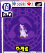

# 088 주게임

## 기본 정보

| 항목 | 내용 |
| --- | --- |
| 도감 ID | 088 |
| 이름 | 주게임 |
| 일본어 이름 | ジュゲーム |
| 속성 | 암(어둠) |
| 종별 레벨 | Lv.2 |

종별 레벨은 종류별로 정해진 값이며, 아래의 랭크와 구분합니다.

## 드래건 설명

자기가 느끼는 아픔을 표적에게 전하는 저주의 드래건. 몸은 작아도 효과는 확실하다.

카드 설명을 정리한 문장입니다. 실제 전투 효과와는 구분합니다.

## 랭크별 기본 능력치

| 랭크 | HP | STR | VIT | INT | MNT | AGI | DEX | LUK |
| ---: | ---: | ---: | ---: | ---: | ---: | ---: | ---: | ---: |
| 1 | 1,400 | 23 | 32 | 27 | 18 | 56 | 80 | 80 |
| 2 | 1,600 | 33 | 46 | 39 | 26 | 80 | 99 | 110 |
| 3 | 1,800 | 43 | 60 | 51 | 34 | 104 | 112 | 140 |
| 4 | 2,000 | 53 | 74 | 63 | 42 | 128 | 119 | 170 |
| 5 | 2,200 | 63 | 88 | 75 | 50 | 152 | 120 | 200 |

ROM에 저장된 기본값이며, 저장 데이터의 성장·개별 보정값은 포함하지 않습니다. 실제 획득 가능 랭크를 확정하는 표는 아닙니다.

`—`는 해당 랭크의 HP와 능력치가 모두 0인 슬롯입니다. 다른 수치와 함께 기록된 0은 그대로 표시했습니다.

[능력치와 대미지](../전투시스템/능력치와대미지.md) · [레벨과 랭크](../육성시스템/레벨과랭크.md)

## 사용 기술

랭크별로 기록된 전체 보유 목록입니다. 기술명을 누르면 AP, 효과와 사용 조건을 확인할 수 있습니다. 같은 이름도 기술 ID가 다르면 별도로 구분합니다.

| 랭크 | 기술 | 충전 | 방어 | 반격 |
| ---: | --- | --- | --- | --- |
| 1 | [태클](../기술목록/타격.md#slot-2125) (2125) | [HP 회복α](../기술목록/충전보조.md#slot-2150) (2150) [싱크로 회복α](../기술목록/충전보조.md#slot-2151) (2151) [LUK 상승γ](../기술목록/충전보조.md#slot-2178) (2178) | [블록](../기술목록/방어.md#slot-2141) (2141) [스웨이](../기술목록/방어.md#slot-2142) (2142) | [반격 태클](../기술목록/반격반사.md#slot-2094) (2094) [리플렉트](../기술목록/반격반사.md#slot-2082) (2082) [인과주](../기술목록/반격반사.md#slot-883) (883) |
| 2 | [태클](../기술목록/타격.md#slot-2125) (2125) [빅 태클](../기술목록/타격.md#slot-2126) (2126) | [HP 회복α](../기술목록/충전보조.md#slot-2150) (2150) [싱크로 회복α](../기술목록/충전보조.md#slot-2151) (2151) [AGI 상승β](../기술목록/충전보조.md#slot-2166) (2166) [LUK 상승γ](../기술목록/충전보조.md#slot-2178) (2178) | [블록](../기술목록/방어.md#slot-2141) (2141) [스웨이](../기술목록/방어.md#slot-2142) (2142) | [반격 태클](../기술목록/반격반사.md#slot-2094) (2094) [리플렉트](../기술목록/반격반사.md#slot-2082) (2082) [인과주](../기술목록/반격반사.md#slot-883) (883) |
| 3 | [태클](../기술목록/타격.md#slot-2125) (2125) [빅 태클](../기술목록/타격.md#slot-2126) (2126) [킹 태클](../기술목록/타격.md#slot-2127) (2127) [광음파](../기술목록/탄.md#slot-880) (880) | [HP 회복α](../기술목록/충전보조.md#slot-2150) (2150) [싱크로 회복β](../기술목록/충전보조.md#slot-2161) (2161) [AGI 상승β](../기술목록/충전보조.md#slot-2166) (2166) [LUK 상승γ](../기술목록/충전보조.md#slot-2178) (2178) | [블록](../기술목록/방어.md#slot-2141) (2141) [스웨이](../기술목록/방어.md#slot-2142) (2142) | [반격 태클](../기술목록/반격반사.md#slot-2094) (2094) [리플렉트](../기술목록/반격반사.md#slot-2082) (2082) [인과주](../기술목록/반격반사.md#slot-883) (883) |
| 4 | [태클](../기술목록/타격.md#slot-2125) (2125) [빅 태클](../기술목록/타격.md#slot-2126) (2126) [킹 태클](../기술목록/타격.md#slot-2127) (2127) [광음파](../기술목록/탄.md#slot-880) (880) [연속 초음파](../기술목록/탄.md#slot-881) (881) | [HP 회복α](../기술목록/충전보조.md#slot-2150) (2150) [싱크로 회복γ](../기술목록/충전보조.md#slot-2171) (2171) [AGI 상승β](../기술목록/충전보조.md#slot-2166) (2166) [LUK 상승γ](../기술목록/충전보조.md#slot-2178) (2178) | [블록](../기술목록/방어.md#slot-2141) (2141) [스웨이](../기술목록/방어.md#slot-2142) (2142) | [반격 태클](../기술목록/반격반사.md#slot-2094) (2094) [리플렉트](../기술목록/반격반사.md#slot-2082) (2082) [인과주](../기술목록/반격반사.md#slot-883) (883) |
| 5 | [태클](../기술목록/타격.md#slot-2125) (2125) [빅 태클](../기술목록/타격.md#slot-2126) (2126) [킹 태클](../기술목록/타격.md#slot-2127) (2127) [광음파](../기술목록/탄.md#slot-880) (880) [연속 초음파](../기술목록/탄.md#slot-881) (881) [투박란](../기술목록/탄.md#slot-882) (882) | [HP 회복α](../기술목록/충전보조.md#slot-2150) (2150) [싱크로 회복γ](../기술목록/충전보조.md#slot-2171) (2171) [AGI 상승γ](../기술목록/충전보조.md#slot-2176) (2176) [LUK 상승γ](../기술목록/충전보조.md#slot-2178) (2178) | [블록](../기술목록/방어.md#slot-2141) (2141) [스웨이](../기술목록/방어.md#slot-2142) (2142) | [반격 태클](../기술목록/반격반사.md#slot-2094) (2094) [리플렉트](../기술목록/반격반사.md#slot-2082) (2082) [인과주](../기술목록/반격반사.md#slot-883) (883) |

`—`는 해당 칸에 유효 기술 ID가 기록되지 않았다는 뜻입니다. 실제 획득 가능 랭크나 특수 성장·변신으로 열리는 기술을 확정하는 표는 아닙니다.

[기술 목록](../기술목록/index.md) · [랭크업](../육성시스템/랭크업.md)

## 변신

이 드래건의 변신 여부와 조건은 확인되지 않았습니다.

[변신 목록](../변신목록/index.md)

## 자료와 확인 범위

V29 ROM 기반 추출 자료를 도감 ID 88로 대조하여 구성했습니다.

| 반영 항목 | 원본 자료와 식별 기준 |
| --- | --- |
| 이름·종별 레벨·속성 | 드래곤목록.md, ID 88 |
| 카드 설명 | 드래건카드목록.md, ID 88의 한글 설명 |
| 랭크별 기본 능력치 | 드래건랭크별능력치.md, 랭크 1~5 각각의 ID 88 |
| 랭크별 보유 기술 | 드래건랭크별보유기술.md, ID 88의 랭크 1~5 |
| 카드 이미지 | image/드래건이미지갤러리.md, image/cards/088.png |

획득 방법과 실제 획득 가능 랭크는 추가 확인이 필요합니다. 보유 기술은 랭크 테이블 기준이며 전투 중 사용 조건은 개별 기술 설명을 참고하세요.

← [준라 안시](087.md) · [드래건 도감](index.md) · [후슈 브레스](089.md) →
