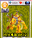

# 122 디스트라 라디오

## 기본 정보

| 항목 | 내용 |
| --- | --- |
| 도감 ID | 122 |
| 이름 | 디스트라 라디오 |
| 일본어 이름 | ディストラレイディオ |
| 속성 | 뇌(번개) |
| 종별 레벨 | Lv.1 |

종별 레벨은 종류별로 정해진 값이며, 아래의 랭크와 구분합니다.

## 드래건 설명

초봄에 이상한 전파를 보내 사람의 마음을 혼란시킨다. 그 밖의 정체는 알려지지 않았다.

카드 설명을 정리한 문장입니다. 실제 전투 효과와는 구분합니다.

## 랭크별 기본 능력치

| 랭크 | HP | STR | VIT | INT | MNT | AGI | DEX | LUK |
| ---: | ---: | ---: | ---: | ---: | ---: | ---: | ---: | ---: |
| 1 | 1,200 | 27 | 24 | 30 | 33 | 60 | 42 | 21 |
| 2 | 1,500 | 45 | 40 | 50 | 55 | 90 | 63 | 32 |
| 3 | 1,800 | 63 | 56 | 70 | 77 | 120 | 84 | 42 |
| 4 | 2,100 | 81 | 72 | 90 | 99 | 150 | 105 | 53 |
| 5 | 2,400 | 99 | 88 | 110 | 121 | 180 | 126 | 63 |

ROM에 저장된 기본값이며, 저장 데이터의 성장·개별 보정값은 포함하지 않습니다. 실제 획득 가능 랭크를 확정하는 표는 아닙니다.

`—`는 해당 랭크의 HP와 능력치가 모두 0인 슬롯입니다. 다른 수치와 함께 기록된 0은 그대로 표시했습니다.

[능력치와 대미지](../전투시스템/능력치와대미지.md) · [레벨과 랭크](../육성시스템/레벨과랭크.md)

## 사용 기술

랭크별로 기록된 전체 보유 목록입니다. 기술명을 누르면 AP, 효과와 사용 조건을 확인할 수 있습니다. 같은 이름도 기술 ID가 다르면 별도로 구분합니다.

| 랭크 | 기술 | 충전 | 방어 | 반격 |
| ---: | --- | --- | --- | --- |
| 1 | [태클](../기술목록/타격.md#slot-2125) (2125) [빔](../기술목록/브레스.md#slot-1220) (1220) | [HP 회복α](../기술목록/충전보조.md#slot-2150) (2150) [싱크로 회복γ](../기술목록/충전보조.md#slot-2171) (2171) [혼란 해제β](../기술목록/충전보조.md#slot-2204) (2204) | [블록](../기술목록/방어.md#slot-2141) (2141) [스웨이](../기술목록/방어.md#slot-2142) (2142) | [반격 태클](../기술목록/반격반사.md#slot-2094) (2094) [리플렉트](../기술목록/반격반사.md#slot-2082) (2082) |
| 2 | [태클](../기술목록/타격.md#slot-2125) (2125) [빅 태클](../기술목록/타격.md#slot-2126) (2126) [빔](../기술목록/브레스.md#slot-1220) (1220) | [HP 회복α](../기술목록/충전보조.md#slot-2150) (2150) [싱크로 회복γ](../기술목록/충전보조.md#slot-2171) (2171) [INT 상승α](../기술목록/충전보조.md#slot-2154) (2154) [혼란 해제β](../기술목록/충전보조.md#slot-2204) (2204) | [블록](../기술목록/방어.md#slot-2141) (2141) [스웨이](../기술목록/방어.md#slot-2142) (2142) | [반격 태클](../기술목록/반격반사.md#slot-2094) (2094) [리플렉트](../기술목록/반격반사.md#slot-2082) (2082) |
| 3 | [태클](../기술목록/타격.md#slot-2125) (2125) [빅 태클](../기술목록/타격.md#slot-2126) (2126) [킹 태클](../기술목록/타격.md#slot-2127) (2127) [빔](../기술목록/브레스.md#slot-1220) (1220) | [HP 회복α](../기술목록/충전보조.md#slot-2150) (2150) [싱크로 회복γ](../기술목록/충전보조.md#slot-2171) (2171) [INT 상승α](../기술목록/충전보조.md#slot-2154) (2154) [DEX 상승β](../기술목록/충전보조.md#slot-2167) (2167) [혼란 해제β](../기술목록/충전보조.md#slot-2204) (2204) | [블록](../기술목록/방어.md#slot-2141) (2141) [스웨이](../기술목록/방어.md#slot-2142) (2142) | [반격 태클](../기술목록/반격반사.md#slot-2094) (2094) [리플렉트](../기술목록/반격반사.md#slot-2082) (2082) |
| 4 | [태클](../기술목록/타격.md#slot-2125) (2125) [빅 태클](../기술목록/타격.md#slot-2126) (2126) [킹 태클](../기술목록/타격.md#slot-2127) (2127) [스핀 태클 S](../기술목록/상태이상.md#slot-2128) (2128) [빔](../기술목록/브레스.md#slot-1220) (1220) [괴이 전자파](../기술목록/상태이상.md#slot-1221) (1221) | [HP 회복α](../기술목록/충전보조.md#slot-2150) (2150) [싱크로 회복γ](../기술목록/충전보조.md#slot-2171) (2171) [INT 상승α](../기술목록/충전보조.md#slot-2154) (2154) [AGI 상승β](../기술목록/충전보조.md#slot-2166) (2166) [DEX 상승β](../기술목록/충전보조.md#slot-2167) (2167) [혼란 해제β](../기술목록/충전보조.md#slot-2204) (2204) | [블록](../기술목록/방어.md#slot-2141) (2141) [스웨이](../기술목록/방어.md#slot-2142) (2142) | [반격 태클](../기술목록/반격반사.md#slot-2094) (2094) [리플렉트](../기술목록/반격반사.md#slot-2082) (2082) |
| 5 | [태클](../기술목록/타격.md#slot-2125) (2125) [빅 태클](../기술목록/타격.md#slot-2126) (2126) [킹 태클](../기술목록/타격.md#slot-2127) (2127) [스핀 태클 S](../기술목록/상태이상.md#slot-2128) (2128) [빔](../기술목록/브레스.md#slot-1220) (1220) [괴이 전자파](../기술목록/상태이상.md#slot-1221) (1221) [기묘한 전자파](../기술목록/상태이상.md#slot-1222) (1222) | [HP 회복α](../기술목록/충전보조.md#slot-2150) (2150) [싱크로 회복γ](../기술목록/충전보조.md#slot-2171) (2171) [INT 상승γ](../기술목록/충전보조.md#slot-2174) (2174) [AGI 상승β](../기술목록/충전보조.md#slot-2166) (2166) [DEX 상승β](../기술목록/충전보조.md#slot-2167) (2167) [기술 봉인 해제α](../기술목록/충전보조.md#slot-2192) (2192) [혼란 해제β](../기술목록/충전보조.md#slot-2204) (2204) | [블록](../기술목록/방어.md#slot-2141) (2141) [스웨이](../기술목록/방어.md#slot-2142) (2142) | [반격 태클](../기술목록/반격반사.md#slot-2094) (2094) [리플렉트](../기술목록/반격반사.md#slot-2082) (2082) |

`—`는 해당 칸에 유효 기술 ID가 기록되지 않았다는 뜻입니다. 실제 획득 가능 랭크나 특수 성장·변신으로 열리는 기술을 확정하는 표는 아닙니다.

[기술 목록](../기술목록/index.md) · [랭크업](../육성시스템/랭크업.md)

## 변신

이 드래건의 변신 여부와 조건은 확인되지 않았습니다.

[변신 목록](../변신목록/index.md)

## 자료와 확인 범위

V29 ROM 기반 추출 자료를 도감 ID 122로 대조하여 구성했습니다.

| 반영 항목 | 원본 자료와 식별 기준 |
| --- | --- |
| 이름·종별 레벨·속성 | 드래곤목록.md, ID 122 |
| 카드 설명 | 드래건카드목록.md, ID 122의 한글 설명 |
| 랭크별 기본 능력치 | 드래건랭크별능력치.md, 랭크 1~5 각각의 ID 122 |
| 랭크별 보유 기술 | 드래건랭크별보유기술.md, ID 122의 랭크 1~5 |
| 카드 이미지 | image/드래건이미지갤러리.md, image/cards/122.png |

획득 방법과 실제 획득 가능 랭크는 추가 확인이 필요합니다. 보유 기술은 랭크 테이블 기준이며 전투 중 사용 조건은 개별 기술 설명을 참고하세요.

← [카즌 R](121.md) · [드래건 도감](index.md) · [마그네스](123.md) →
