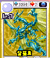

# 170 알플로

## 기본 정보

| 항목 | 내용 |
| --- | --- |
| 도감 ID | 170 |
| 이름 | 알플로 |
| 일본어 이름 | アルフロー |
| 속성 | 무(무속성) |
| 종별 레벨 | Lv.? |

종별 레벨은 종류별로 정해진 값이며, 아래의 랭크와 구분합니다.

`Lv.?`는 원본의 레벨 값이 FF(-1)인 특수 표기입니다.

## 드래건 설명

대지 위에 그림자를 드리우는 건 웅장히 펼친 황금 날개. 아득히 높은 곳에서 땅을 내려다본다.

카드 설명을 정리한 문장입니다. 실제 전투 효과와는 구분합니다.

## 랭크별 기본 능력치

| 랭크 | HP | STR | VIT | INT | MNT | AGI | DEX | LUK |
| ---: | ---: | ---: | ---: | ---: | ---: | ---: | ---: | ---: |
| 1 | 8,000 | 60 | 60 | 60 | 60 | 60 | 85 | 80 |
| 2 | — | — | — | — | — | — | — | — |
| 3 | — | — | — | — | — | — | — | — |
| 4 | — | — | — | — | — | — | — | — |
| 5 | — | — | — | — | — | — | — | — |

ROM에 저장된 기본값이며, 저장 데이터의 성장·개별 보정값은 포함하지 않습니다. 실제 획득 가능 랭크를 확정하는 표는 아닙니다.

`—`는 해당 랭크의 HP와 능력치가 모두 0인 슬롯입니다. 다른 수치와 함께 기록된 0은 그대로 표시했습니다.

[능력치와 대미지](../전투시스템/능력치와대미지.md) · [레벨과 랭크](../육성시스템/레벨과랭크.md)

## 사용 기술

랭크별로 기록된 전체 보유 목록입니다. 기술명을 누르면 AP, 효과와 사용 조건을 확인할 수 있습니다. 같은 이름도 기술 ID가 다르면 별도로 구분합니다.

| 랭크 | 기술 | 충전 | 방어 | 반격 |
| ---: | --- | --- | --- | --- |
| 1 | [팽](../기술목록/타격.md#slot-2106) (2106) [더블 팽](../기술목록/타격.md#slot-2107) (2107) [공렬](../기술목록/탄.md#slot-1700) (1700) [난무람](../기술목록/탄.md#slot-1701) (1701) [안광살](../기술목록/브레스.md#slot-1702) (1702) [초파동](../기술목록/브레스.md#slot-1703) (1703) | [HP 회복β](../기술목록/충전보조.md#slot-2160) (2160) [싱크로 회복β](../기술목록/충전보조.md#slot-2161) (2161) [VIT 상승β](../기술목록/충전보조.md#slot-2163) (2163) [INT 상승β](../기술목록/충전보조.md#slot-2164) (2164) [MNT 상승β](../기술목록/충전보조.md#slot-2165) (2165) [AGI 상승β](../기술목록/충전보조.md#slot-2166) (2166) | [블록](../기술목록/방어.md#slot-2141) (2141) [스웨이](../기술목록/방어.md#slot-2142) (2142) | [반격 팽](../기술목록/반격반사.md#slot-2091) (2091) [리플렉트](../기술목록/반격반사.md#slot-2082) (2082) |
| 2 | — | — | — | — |
| 3 | — | — | — | — |
| 4 | — | — | — | — |
| 5 | — | — | — | — |

`—`는 해당 칸에 유효 기술 ID가 기록되지 않았다는 뜻입니다. 실제 획득 가능 랭크나 특수 성장·변신으로 열리는 기술을 확정하는 표는 아닙니다.

[기술 목록](../기술목록/index.md) · [랭크업](../육성시스템/랭크업.md)

## 변신

코알 계열의 변신 관련 형태입니다. 변신은 싱크로 카운트가 필요한 별도 전투 명령입니다.

| 단계 | 관련 형태 | 확인된 조건 |
| --- | --- | --- |
| 기본형 | [코알](161.md) | 기본 형태로 돌아가는 선택지 |
| 1단계 | [아트랄](162.md) · [마레알](163.md) · [아에랄](164.md) | 성장 기록 10개부터 두 분류값의 조합으로 한 형태 선택 |
| 2단계 | [알란더](165.md) · [알그란](166.md) · [알 어비스](167.md) · [알셴](168.md) · [알윈](169.md) · [알플로](170.md) | 성장 기록 20개부터 앞선 분류값과 첫 19개 기록으로 한 형태 선택 |
| 3단계 | [디 에러](184.md) | 성장 기록 30개가 필요하며, 첫 30개가 모두 4 이하이거나 모두 5 이상 |

2단계는 첫 19개 기록 중 4 이하가 더 많으면 아트랄 계열은 알란더, 마레알 계열은 알 어비스, 아에랄 계열은 알윈으로 이어집니다. 반대 분기는 각각 알그란, 알셴, 알플로입니다. 형태별 비용 차이와 성공 경계값은 확인되지 않았습니다.

[변신 목록](../변신목록/index.md)

## 자료와 확인 범위

V29 ROM 기반 추출 자료를 도감 ID 170로 대조하여 구성했습니다.

| 반영 항목 | 원본 자료와 식별 기준 |
| --- | --- |
| 이름·종별 레벨·속성 | 드래곤목록.md, ID 170 |
| 카드 설명 | 드래건카드목록.md, ID 170의 한글 설명 |
| 랭크별 기본 능력치 | 드래건랭크별능력치.md, 랭크 1~5 각각의 ID 170 |
| 랭크별 보유 기술 | 드래건랭크별보유기술.md, ID 170의 랭크 1~5 |
| 카드 이미지 | image/드래건이미지갤러리.md, image/cards/170.png |
| 변신 | 전투기술전체데이터.md, 변신 절 |

획득 방법과 실제 획득 가능 랭크는 추가 확인이 필요합니다. 보유 기술은 랭크 테이블 기준이며 전투 중 사용 조건은 개별 기술 설명을 참고하세요.

← [알윈](169.md) · [드래건 도감](index.md) · [바커스 가더](171.md) →
