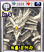

# 180 코룸나 아라

## 기본 정보

| 항목 | 내용 |
| --- | --- |
| 도감 ID | 180 |
| 이름 | 코룸나 아라 |
| 일본어 이름 | コルムナアーラ |
| 속성 | 갑(갑주) |
| 종별 레벨 | Lv.5 |

종별 레벨은 종류별로 정해진 값이며, 아래의 랭크와 구분합니다.

## 드래건 설명

돌로 된 몸을 움직여 신들의 신상이 하늘을 난다. 신벌을 두려워하지 않는 자에겐 천벌을!

카드 설명을 정리한 문장입니다. 실제 전투 효과와는 구분합니다.

## 랭크별 기본 능력치

| 랭크 | HP | STR | VIT | INT | MNT | AGI | DEX | LUK |
| ---: | ---: | ---: | ---: | ---: | ---: | ---: | ---: | ---: |
| 1 | 8,800 | 90 | 144 | 108 | 144 | 33 | 56 | 7 |
| 2 | 9,350 | 108 | 174 | 130 | 174 | 40 | 66 | 9 |
| 3 | 9,900 | 127 | 205 | 153 | 205 | 48 | 77 | 10 |
| 4 | 10,450 | 146 | 236 | 176 | 236 | 56 | 88 | 12 |
| 5 | 11,000 | 165 | 267 | 199 | 267 | 64 | 99 | 13 |

ROM에 저장된 기본값이며, 저장 데이터의 성장·개별 보정값은 포함하지 않습니다. 실제 획득 가능 랭크를 확정하는 표는 아닙니다.

`—`는 해당 랭크의 HP와 능력치가 모두 0인 슬롯입니다. 다른 수치와 함께 기록된 0은 그대로 표시했습니다.

[능력치와 대미지](../전투시스템/능력치와대미지.md) · [레벨과 랭크](../육성시스템/레벨과랭크.md)

## 사용 기술

랭크별로 기록된 전체 보유 목록입니다. 기술명을 누르면 AP, 효과와 사용 조건을 확인할 수 있습니다. 같은 이름도 기술 ID가 다르면 별도로 구분합니다.

| 랭크 | 기술 | 충전 | 방어 | 반격 |
| ---: | --- | --- | --- | --- |
| 1 | [펀치](../기술목록/타격.md#slot-2131) (2131) [후광격](../기술목록/타격.md#slot-1800) (1800) | [HP 회복β](../기술목록/충전보조.md#slot-2160) (2160) [VIT 상승β](../기술목록/충전보조.md#slot-2163) (2163) | [블록](../기술목록/방어.md#slot-2141) (2141) [스웨이](../기술목록/방어.md#slot-2142) (2142) | [반격 펀치](../기술목록/반격반사.md#slot-2095) (2095) [리플렉트](../기술목록/반격반사.md#slot-2082) (2082) |
| 2 | [펀치](../기술목록/타격.md#slot-2131) (2131) [슈퍼 펀치](../기술목록/타격.md#slot-2132) (2132) [후광격](../기술목록/타격.md#slot-1800) (1800) | [HP 회복β](../기술목록/충전보조.md#slot-2160) (2160) [VIT 상승β](../기술목록/충전보조.md#slot-2163) (2163) [MNT 상승β](../기술목록/충전보조.md#slot-2165) (2165) | [블록](../기술목록/방어.md#slot-2141) (2141) [스웨이](../기술목록/방어.md#slot-2142) (2142) | [반격 펀치](../기술목록/반격반사.md#slot-2095) (2095) [리플렉트](../기술목록/반격반사.md#slot-2082) (2082) |
| 3 | [펀치](../기술목록/타격.md#slot-2131) (2131) [슈퍼 펀치](../기술목록/타격.md#slot-2132) (2132) [미라클 펀치](../기술목록/타격.md#slot-2133) (2133) [후광격](../기술목록/타격.md#slot-1800) (1800) [천벌진](../기술목록/탄.md#slot-1801) (1801) | [HP 회복β](../기술목록/충전보조.md#slot-2160) (2160) [VIT 상승β](../기술목록/충전보조.md#slot-2163) (2163) [INT 상승β](../기술목록/충전보조.md#slot-2164) (2164) [MNT 상승β](../기술목록/충전보조.md#slot-2165) (2165) [독 해제β](../기술목록/충전보조.md#slot-2201) (2201) | [블록](../기술목록/방어.md#slot-2141) (2141) [스웨이](../기술목록/방어.md#slot-2142) (2142) | [반격 펀치](../기술목록/반격반사.md#slot-2095) (2095) [리플렉트](../기술목록/반격반사.md#slot-2082) (2082) |
| 4 | [펀치](../기술목록/타격.md#slot-2131) (2131) [슈퍼 펀치](../기술목록/타격.md#slot-2132) (2132) [미라클 펀치](../기술목록/타격.md#slot-2133) (2133) [후광격](../기술목록/타격.md#slot-1800) (1800) [천벌진](../기술목록/탄.md#slot-1801) (1801) [신의 시련](../기술목록/브레스.md#slot-1802) (1802) | [HP 회복β](../기술목록/충전보조.md#slot-2160) (2160) [싱크로 회복β](../기술목록/충전보조.md#slot-2161) (2161) [VIT 상승β](../기술목록/충전보조.md#slot-2163) (2163) [INT 상승β](../기술목록/충전보조.md#slot-2164) (2164) [MNT 상승β](../기술목록/충전보조.md#slot-2165) (2165) [독 해제β](../기술목록/충전보조.md#slot-2201) (2201) [기술 봉인 해제β](../기술목록/충전보조.md#slot-2202) (2202) | [블록](../기술목록/방어.md#slot-2141) (2141) [스웨이](../기술목록/방어.md#slot-2142) (2142) | [반격 펀치](../기술목록/반격반사.md#slot-2095) (2095) [리플렉트](../기술목록/반격반사.md#slot-2082) (2082) |
| 5 | [펀치](../기술목록/타격.md#slot-2131) (2131) [슈퍼 펀치](../기술목록/타격.md#slot-2132) (2132) [미라클 펀치](../기술목록/타격.md#slot-2133) (2133) [후광격](../기술목록/타격.md#slot-1800) (1800) [천벌진](../기술목록/탄.md#slot-1801) (1801) [신의 시련](../기술목록/브레스.md#slot-1802) (1802) [신들의 산](../기술목록/탄.md#slot-1803) (1803) | [HP 회복β](../기술목록/충전보조.md#slot-2160) (2160) [싱크로 회복β](../기술목록/충전보조.md#slot-2161) (2161) [VIT 상승β](../기술목록/충전보조.md#slot-2163) (2163) [INT 상승β](../기술목록/충전보조.md#slot-2164) (2164) [MNT 상승β](../기술목록/충전보조.md#slot-2165) (2165) [독 해제β](../기술목록/충전보조.md#slot-2201) (2201) [기술 봉인 해제β](../기술목록/충전보조.md#slot-2202) (2202) [혼란 해제α](../기술목록/충전보조.md#slot-2194) (2194) | [블록](../기술목록/방어.md#slot-2141) (2141) [스웨이](../기술목록/방어.md#slot-2142) (2142) | [반격 펀치](../기술목록/반격반사.md#slot-2095) (2095) [리플렉트](../기술목록/반격반사.md#slot-2082) (2082) |

`—`는 해당 칸에 유효 기술 ID가 기록되지 않았다는 뜻입니다. 실제 획득 가능 랭크나 특수 성장·변신으로 열리는 기술을 확정하는 표는 아닙니다.

[기술 목록](../기술목록/index.md) · [랭크업](../육성시스템/랭크업.md)

## 변신

이 드래건의 변신 여부와 조건은 확인되지 않았습니다.

[변신 목록](../변신목록/index.md)

## 자료와 확인 범위

V29 ROM 기반 추출 자료를 도감 ID 180로 대조하여 구성했습니다.

| 반영 항목 | 원본 자료와 식별 기준 |
| --- | --- |
| 이름·종별 레벨·속성 | 드래곤목록.md, ID 180 |
| 카드 설명 | 드래건카드목록.md, ID 180의 한글 설명 |
| 랭크별 기본 능력치 | 드래건랭크별능력치.md, 랭크 1~5 각각의 ID 180 |
| 랭크별 보유 기술 | 드래건랭크별보유기술.md, ID 180의 랭크 1~5 |
| 카드 이미지 | image/드래건이미지갤러리.md, image/cards/180.png |

획득 방법과 실제 획득 가능 랭크는 추가 확인이 필요합니다. 보유 기술은 랭크 테이블 기준이며 전투 중 사용 조건은 개별 기술 설명을 참고하세요.

← [라이이안](179.md) · [드래건 도감](index.md) · [살칸드라](181.md) →
