# D 파츠

[아이템 목록으로 돌아가기](index.md)

드래건이 장착하면 효과가 적용됩니다.

| ID | 이미지 | 이름 | 게임 설명 | 효과 |
| ---: | :---: | --- | --- | --- |
| 01 | 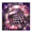 | **가드 스케일** ガードスケイル | 장착 시 브레스와 탄 공격에 대한 방어력이 크게 오른다. | MNT +30% |
| 02 | 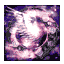 | **엑스 윙** エクスウィング | 장착 시 속도가 크게 올라 적의 공격을 피하기 쉬워진다. | AGI +30% |
| 03 | 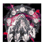 | **엑스 레그** エクスレッグ | 장착 시 타격 방어력이 크게 오른다. | VIT +30% |
| 04 | 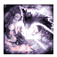 | **블라스트 핀** ブラストフィン | 장착 시 브레스와 탄 공격력이 크게 오른다. | INT +30% |
| 05 | 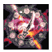 | **루나 엣지** ルナエッジ | 장착 시 타격 공격력과 방어력이 오른다. | STR·VIT 각각 +10% |
| 06 | 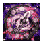 | **솔 엣지** ソルエッジ | 장착 시 브레스와 탄 공격력 및 방어력이 오른다. | INT·MNT 각각 +10% |
| 07 | 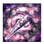 | **드릴 혼** ドリルホーン | 장착 시 브레스와 탄 공격력이 오른다. | INT +20% |
| 08 | 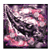 | **스트롱 혼** ストロングホーン | 장착 시 타격 공격력이 오른다. | STR +20% |
| 09 | 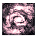 | **스파이더 웹** スパイダーウェブ | 장착 시 상태이상에 걸리지 않는다. | 상태이상 면역 |
| 10 | 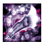 | **메르쿠리우스 엣지** メリクリウスエッジ | 장착 시 기교가 크게 오른다. | DEX +30% |
| 11 | 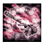 | **드래건 바주카** ドラゴンバズーカ | 장착 시 타격 공격력이 크게 오른다. | STR +30% |
| 12 | 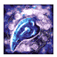 | **포이즌 팽** ポイズンファング | 장착 시 공격으로 상대에게 독을 건다. | 공격 시 독 부여 |
| 13 | 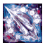 | **마르스 엣지** マルスエッジ | 장착 시 공격으로 상대에게 공포를 건다. | 공격 시 공포 부여 |
| 14 | 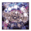 | **챔피언 벨트** チャンピオンベルト | 장착 시 타격과 브레스·탄 공격력이 크게 오른다. | STR·INT 각각 +30% |
| 15 | 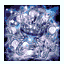 | **크라운즈 크라운** クラウンズクラウン | 장착 시 타격과 브레스·탄 방어력이 크게 오른다. | VIT·MNT 각각 +30% |
| 16 | 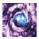 | **엘리멘털 시프트** エレメンタルシフト | 장착 시 상황에 관계없이 필살기를 쓸 수 있다. | 필살기 사용 조건 완화 |

## 확인 범위

V29 ROM에서 추출한 아이템 설명과 효과 테이블 대조 결과를 반영했습니다. 일정 시간이라고만 기재된 효과의 지속 시간과 상태 이상 부여 확률은 확인이 필요합니다.

엘리멘털 시프트가 완화하는 필살기 조건의 범위는 추가 확인이 필요합니다.

입수처는 현재 추출 자료에 없어 추가 확인 후 반영합니다.

[상태 이상 효과와 해제·예방](../전투시스템/상태이상.md) · [아이템 목록](index.md)
