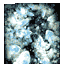

# 전투 아이템 카드

[아이템 목록으로 돌아가기](index.md)

전투에서 사용하는 카드입니다. 블랭크는 게놈 코드 입력에도 사용합니다.

| ID | 이미지 | 이름 | 게임 설명 | 효과 |
| ---: | :---: | --- | --- | --- |
| 17 |  | **간파의 극의** 見切りの極意 | 일정 시간 적의 기교를 낮춰 공격을 피하기 쉽게 한다. | 적 DEX −20% |
| 18 |  | **번아웃** バーンナウト | 적 드래건에게 피해를 준다. | 적에게 고정 피해 1,000 |
| 19 |  | **디스트럭트** デストラクト | 적이 장착 중인 D 파츠를 부순다. | 적 장착 D 파츠 파괴 |
| 20 |  | **엘릭서** エリクサー | 드래건의 HP를 전부 회복한다. | HP를 최대치로 회복 |
| 21 |  | **방어 결계** 防御結界 | 일정 시간 적의 타격과 브레스·탄 공격력을 낮춘다. | 적 STR·INT 각각 −20% |
| 22 |  | **술식 봉인** 術式封印 | 모든 상태 변화를 해제한다. | 상태 변화 초기화 |
| 23 |  | **황천 귀환** 黄泉戻し | 쓰러진 드래건을 되살린다. | 전투 불능 드래건 부활 |
| 24 |  | **태초의 소용돌이** 原初のうず | 적 드래건에게 큰 피해를 준다. | 적에게 고정 피해 5,000 |
| 25 |  | **드래건 콜로세움** ドラゴンコロセウム | 적 드래건의 모든 능력치를 낮춘다. | 적 STR·VIT·INT·MNT·AGI·DEX·LUK 각각 −20% |
| 26 |  | **전투 실험장** 戦闘実験場 | 일정 시간 적 드래건의 속도를 낮춘다. | 적 AGI −20% |
| 27 |  | **아카키 마즈** アカキマーズ | 일정 시간 적의 타격과 브레스·탄 방어력을 낮춘다. | 적 VIT·MNT 각각 −20% |
| 28 |  | **크리스털 프리즌** クリスタルプリズン | 일정 시간 적의 AP가 늘지 않고 행동할 수 없게 된다. | 적 AP 증가 차단 및 행동 불가 |
| 29 |  | **데스티니** ディスティニー | 절반의 확률로 적이나 아군 드래건을 빈사 상태로 만든다. | 적·아군 중 무작위로 한쪽이 빈사 |
| 30 |  | **블랭크** ブランク | 전투에서 적 드래건을 포획하는 데 쓴다. 게놈 코드 입력에도 사용한다. | 적 드래건 포획 또는 게놈 코드 입력 |

## 확인 범위

V29 ROM에서 추출한 아이템 설명과 효과 테이블 대조 결과를 반영했습니다. 일정 시간이라고만 기재된 효과의 지속 시간과 상태 이상 부여 확률은 확인이 필요합니다.

황천 귀환으로 되살아날 때의 HP는 추가 확인이 필요합니다.

입수처는 현재 추출 자료에 없어 추가 확인 후 반영합니다.

[상태 이상 효과와 해제·예방](../전투시스템/상태이상.md) · [아이템 목록](index.md)
